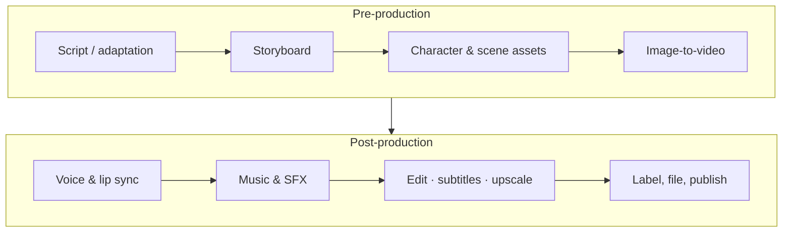

# Awesome AI Drama

   

[简体中文](README.md) | **English**

A curated list of open-source tools for making AI short dramas and AI motion comics (manju), from script and storyboard to consistent characters, video generation, voice, lip sync, editing and release. Every entry shows its stars and last update, refreshed and re-ranked weekly.

## Why this list

AI dramas now make up most of China's micro-drama output: an [article on The Paper's creator platform](https://www.thepaper.cn/newsDetail_forward_33483129), citing the China Netcasting Services Association, says that about 122,000 of the roughly 128,000 micro-dramas released in Q1 2026 were AI-made. Open-source projects in this space are multiplying but scattered. This list keeps the ones that work and are still maintained, ordered by production stage, plus the Chinese rules you need to know before publishing.

## Production pipeline

## Quick start: pick a route

| Route | For | Suggested stack |
|---|---|---|
| No code | Fastest results | [Jimeng](https://jimeng.jianying.com/) or [Kling](https://kling.ai/) for shots + [IndexTTS](https://github.com/index-tts/index-tts) for voice + [VideoCaptioner](https://github.com/WEIFENG2333/VideoCaptioner) for subtitles |
| All-in-one open studio | A full workspace you can self-host | [Toonflow](https://github.com/HBAI-Ltd/Toonflow-app) or [LocalMiniDrama](https://github.com/xuanyustudio/LocalMiniDrama) with your own model keys |
| Fully local | You have a GPU and want control | [ComfyUI](https://github.com/Comfy-Org/ComfyUI) + [Wan2.2](https://github.com/Wan-Video/Wan2.2) + [Qwen-Image](https://github.com/QwenLM/Qwen-Image) for character sheets + [GPT-SoVITS](https://github.com/RVC-Boss/GPT-SoVITS) + [InfiniteTalk](https://github.com/MeiGen-AI/InfiniteTalk) for lip sync |
| Agent workflow | Claude Code or Codex writes scripts and shots | [shuohao-skills](https://github.com/eternityspring/shuohao-skills) or [drama-skills](https://github.com/zenstory-ai/drama-skills), then any video model |

## Contents

- [Quick start: pick a route](#quick-start-pick-a-route)
- [All-in-one drama studios](#all-in-one-drama-studios)
- [Agent skills (script, storyboard, prompts)](#agent-skills-script-storyboard-prompts)
- [Open video generation models](#open-video-generation-models)
- [Character consistency and image generation](#character-consistency-and-image-generation)
- [Voice, TTS and voice cloning](#voice-tts-and-voice-cloning)
- [Lip sync and talking video](#lip-sync-and-talking-video)
- [Music and sound effects](#music-and-sound-effects)
- [Editing, subtitles and post-production](#editing-subtitles-and-post-production)
- [Narration, novel promos and short video](#narration-novel-promos-and-short-video)
- [ComfyUI ecosystem](#comfyui-ecosystem)
- [Prompt and case libraries](#prompt-and-case-libraries)
- [Commercial models and platforms (not open source)](#commercial-models-and-platforms-not-open-source)
- [Rules for publishing in mainland China](#rules-for-publishing-in-mainland-china)
- [Related lists](#related-lists)
- [Contributing](#contributing)

Legend: 🆕 created in the last 90 days　💤 no update for over a year　⭐ stars (as of 2026-11-09)

## All-in-one drama studios

Open-source workspaces that take a novel or a one-line idea through script, character assets, storyboard, image and video generation to a finished cut. Most can be self-hosted with your own model keys.

| Project | Description | ⭐ | Last update |
|---|---|---:|---|
| [Toonflow-app](https://github.com/HBAI-Ltd/Toonflow-app) | Drama and motion-comic studio with an infinite canvas, AI agents and visual workflows covering script, storyboard, assets and image/video generation; self-hostable with MCP and plugins. | 21.1k | 2026-11 |
| [huobao-drama](https://github.com/chatfire-AI/huobao-drama) | Huobao Drama, an end-to-end generator that turns one sentence into a finished short drama. | 17.1k | 2026-11 |
| [dramaclaw](https://github.com/dramaclaw/dramaclaw) | General-purpose AIGC video engine with one pipeline from script to film, for dramas, ads and product videos. | 7.5k | 2026-11 |
| [printfilm](https://github.com/yi1108/printfilm) 🆕 | Platform for AI short-video marketing and AI short-drama creation. | 7.4k | 2026-11 |
| [Jellyfish](https://github.com/Forget-C/Jellyfish) | End-to-end production workspace for AI short dramas, from script and structured storyboards to consistency management, generation and export. | 7.1k | 2026-07 |
| [ArcReel](https://github.com/ArcReel/ArcReel) | Self-hosted, agent-driven workspace that turns novels and scripts into assets, storyboards, videos and CapCut drafts, with cross-shot consistency and cost tracking. | 6.3k | 2026-11 |
| [BigBanana-AI-Director](https://github.com/shuyu-labs/BigBanana-AI-Director) | AI drama director platform built on a Script-to-Asset-to-Keyframe workflow for consistent characters, scenes and camera moves. | 2.4k | 2026-11 |
| [LocalMiniDrama](https://github.com/xuanyustudio/LocalMiniDrama) | Local-first AI drama maker, story to storyboard to video with data kept on your machine; supports Seedance 2. | 2.4k | 2026-11 |
| [ai_story](https://github.com/xhongc/ai_story) | Automated generator for AI videos, anime clips and AI dramas. | 2.0k | 2026-10 |
| [AIComicBuilder](https://github.com/LingyiChen-AI/AIComicBuilder) | Turns scripts into animated comic videos with AI character design, storyboarding and video synthesis. | 2.0k | 2026-04 |
| [ai-fusion-video](https://github.com/Stonewuu/ai-fusion-video) | Agent-based end-to-end platform for short dramas, motion comics and videos, built with Java and AgentScope. | 1.7k | 2026-11 |
| [LingGuo-Drama](https://github.com/LingGuoAI/LingGuo-Drama) | Lingguo Drama, a one-stop generator for mini-dramas and motion comics. | 1.7k | 2026-08 |
| [lumenx](https://github.com/alibaba/lumenx) | LumenX Studio from Alibaba, turning novel text into motion video through script analysis, character design, storyboarding and synthesis. | 1.5k | 2026-10 |
| [aid-studio](https://github.com/shijue-aid/aid-studio) | Self-hostable studio for AI dramas, films and comics with script, assets, storyboards, generation, dubbing and preview. | 1.4k | 2026-10 |
| [StoryGen-Atelier](https://github.com/0xsline/StoryGen-Atelier) | Storyboard and video tool using Gemini for boards and frames, Veo for transition clips and ffmpeg for the final cut. | 1.0k | 2026-09 |
| [TypeTale](https://github.com/TypeTale/TypeTale) | TypeTale, a free AIGC video app for AI dramas, films and novel-promo videos. | 909 | 2026-08 |
| [wind-comic](https://github.com/ChrisChen667788/wind-comic) | Multi-agent pipeline from one line of text to a short drama with script, cinematic boards and character-consistent video; provider-agnostic. | 707 | 2026-11 |
| [novanova-studio](https://github.com/Swayingleaves/novanova-studio) | Agent-driven platform with image and video generation, infinite canvas, novel-to-drama and a 3D director stage. | 701 | 2026-11 |
| [Nomi](https://github.com/aqm857886159/Nomi) | Local-first AI video workbench; bring any model or local ComfyUI and let Claude Code or Codex direct it over MCP into an editable first cut. | 633 | 2026-11 |
| [CineGen-ShortDrama](https://github.com/UllrAI/CineGen-ShortDrama) | AI director system for manga dramas, anime, short dramas and motion comics. | 571 | 2026-09 |
| [Open-AI-Micro-Drama-Generator](https://github.com/Anil-matcha/Open-AI-Micro-Drama-Generator) | Multi-agent micro-drama generator, screenwriter to storyboard to frames to video. | 569 | 2026-08 |
| [KomaSlate](https://github.com/xeronsh/KomaSlate) | Local-first, non-destructive AI storyboarding workspace with shot retakes, version diffs and FCPXML export. | 413 | 2026-11 |
| [novelvids](https://github.com/Anning01/novelvids) | Self-hostable AI drama workspace covering story, character assets, storyboards and generation. | 362 | 2026-11 |
| [AI-Canvas-tauri](https://github.com/Tenney95/AI-Canvas-tauri) | Free, lightweight AI canvas for drama scripts, characters, storyboards, generation and editing, with ComfyUI, agents and MCP. | 342 | 2026-11 |
| [Kinema](https://github.com/chillzhuang/Kinema) 🆕 | Video agent driven by Codex or Claude Code that plans chapters and shots and manages assets through to the final film. | 242 | 2026-09 |

## Agent skills (script, storyboard, prompts)

Skill packs for Claude Code, Codex, DeepSeek Harness and similar agents, for people who already have generation tools and want the agent to write scripts and shot lists.

| Project | Description | ⭐ | Last update |
|---|---|---:|---|
| [seedance-2.0](https://github.com/Emily2040/seedance-2.0) | Full production pipeline for filmmaking with Seedance 2.0. | 8.1k | 2026-10 |
| [shuohao-skills](https://github.com/eternityspring/shuohao-skills) | Short-drama skills for character bibles, adaptation outlines, art bibles, screenplays and storyboards. | 6.3k | 2026-10 |
| [seedance2-skill](https://github.com/dexhunter/seedance2-skill) | Skill for writing strong Seedance 2.0 video prompts. | 4.4k | 2026-09 |
| [drama-skills](https://github.com/zenstory-ai/drama-skills) | Novel-to-script, character turnarounds, shot lists, generation prompts and final-cut review. | 4.0k | 2026-11 |
| [seedance-prompt-skill](https://github.com/songguoxs/seedance-prompt-skill) | Skill that writes Seedance 2.0 video prompts. | 3.0k | 2026-02 |
| [Seedance2-Storyboard-Generator](https://github.com/liangdabiao/Seedance2-Storyboard-Generator) | Turns novels and stories into multi-episode scripts and storyboards designed for Seedance 2.0. | 2.8k | 2026-10 |
| [manju-laoli-skill](https://github.com/lixiaoxiao9888-create/manju-laoli-skill) 🆕 | Manga-drama suite with one director skill and 12 sub-skills for research, script, assets, shots and QA. | 2.0k | 2026-11 |
| [short-drama](https://github.com/0xsline/short-drama) | Short-drama screenwriting skill from concept and episodes to self-review, compliance and overseas release. | 1.6k | 2026-04 |
| [ai-manju-skills](https://github.com/zhanghao123vip/ai-manju-skills) 🆕 | AI manga-drama skills across 21 genres, from one idea to plan, asset prompts, episodes, shots and video prompts. | 630 | 2026-11 |
| [short-drama-factory](https://github.com/lixiaoxiao9888-create/short-drama-factory) | Industrial short-drama screenwriting system that turns an idea or web novel into a 30 to 100 episode script. | 564 | 2026-10 |
| [screen-creative-skills](https://github.com/VanGong1999/screen-creative-skills) | 31 film and TV development skills for IP adaptation, premise, character bios, breakdowns and outlines. | 501 | 2026-10 |
| [OnlyShot](https://github.com/A-cat-with-carrots/OnlyShot) | Five-step short-drama pipeline (script, shots, frames, video, edit) integrated with Jimeng and Seedance. | 399 | 2026-07 |
| [Micro-Drama-Skills](https://github.com/zhaihao118/Micro-Drama-Skills) | Claude Skills that automate a micro-drama workflow from script and characters to storyboards and video jobs. | 331 | 2026-02 |
| [story-shot-agent](https://github.com/neopen/story-shot-agent) | Agent that splits any script into shots and writes consistent text-to-video prompts across them. | 239 | 2026-11 |
| [Wan-skills](https://github.com/Wan-Video/Wan-skills) | Official Wan agent skills for calling Wan generation from your agent. | 77 | 2026-04 |

## Open video generation models

Video models with downloadable weights for local runs or ComfyUI. Without enough VRAM, start with their hosted APIs or a cloud ComfyUI.

| Project | Description | ⭐ | Last update |
|---|---|---:|---|
| [Open-Sora](https://github.com/hpcaitech/Open-Sora) | Open-Sora, efficient open video generation for everyone. | 29.9k | 2026-04 |
| [Wan2.2](https://github.com/Wan-Video/Wan2.2) | Wan2.2 from Alibaba, an open large-scale video model for text-to-video and image-to-video. | 18.5k | 2026-09 |
| [Wan2.1](https://github.com/Wan-Video/Wan2.1) | Wan2.1, the previous Wan generation, with many community workflows and LoRAs. | 17.4k | 2026-03 |
| [FramePack](https://github.com/lllyasviel/FramePack) 💤 | Makes long video diffusion practical on consumer GPUs. | 17.3k | 2025-10 |
| [CogVideo](https://github.com/zai-org/CogVideo) 💤 | CogVideoX from Zhipu, text-to-video and image-to-video. | 13.2k | 2025-11 |
| [HunyuanVideo](https://github.com/Tencent-Hunyuan/HunyuanVideo) | Tencent Hunyuan video generation framework. | 12.7k | 2026-10 |
| [LTX-Video](https://github.com/Lightricks/LTX-Video) | LTX-Video, a fast open video model. | 11.3k | 2026-11 |
| [LTX-2](https://github.com/Lightricks/LTX-2) | LTX-2 audio-video model with an official LoRA trainer. | 10.2k | 2026-11 |
| [SkyReels-V2](https://github.com/SkyworkAI/SkyReels-V2) | SkyReels-V2, an infinite-length film generation model. | 7.8k | 2026-01 |
| [HunyuanVideo-1.5](https://github.com/Tencent-Hunyuan/HunyuanVideo-1.5) | HunyuanVideo-1.5, a lightweight video model. | 4.6k | 2026-04 |
| [MAGI-1](https://github.com/SandAI-org/MAGI-1) | Autoregressive large-scale video generation that extends clip by clip. | 3.8k | 2026-06 |
| [Helios](https://github.com/PKU-YuanGroup/Helios) | Real-time long video generation model. | 2.3k | 2026-11 |
| [HunyuanVideo-I2V](https://github.com/Tencent-Hunyuan/HunyuanVideo-I2V) | Customizable image-to-video model based on HunyuanVideo. | 1.9k | 2026-04 |
| [SkyReels-V3](https://github.com/SkyworkAI/SkyReels-V3) | SkyReels V3 multimodal video generation model. | 596 | 2026-01 |

## Character consistency and image generation

Keeping a character on-model across shots is the hardest part of AI drama. Use these to make stable character sheets and keyframes before image-to-video.

| Project | Description | ⭐ | Last update |
|---|---|---:|---|
| [flux](https://github.com/black-forest-labs/flux) 💤 | Official inference code for the FLUX.1 models. | 26.0k | 2025-07 |
| [InstantID](https://github.com/instantX-research/InstantID) 💤 | Zero-shot identity-preserving generation from a single photo. | 12.0k | 2024-07 |
| [Qwen-Image](https://github.com/QwenLM/Qwen-Image) | Qwen-Image, strong at complex text rendering and precise editing, good for Chinese text in frame. | 8.5k | 2026-02 |
| [IP-Adapter](https://github.com/tencent-ailab/IP-Adapter) 💤 | Image-prompt adapter widely used to lock a character or style. | 6.7k | 2024-06 |
| [OmniGen2](https://github.com/VectorSpaceLab/OmniGen2) | Unified multimodal generation and editing model. | 4.1k | 2026-03 |
| [PuLID](https://github.com/ToTheBeginning/PuLID) 💤 | Fast identity customization. | 3.6k | 2025-07 |
| [UNO](https://github.com/bytedance/UNO) 💤 | ByteDance UNO for single- and multi-subject customization, useful for several characters in one frame. | 1.4k | 2025-09 |
| [USO](https://github.com/bytedance/USO) 💤 | ByteDance USO, unified style- and subject-driven generation. | 1.2k | 2025-09 |

## Voice, TTS and voice cloning

Character voices and narration. For multi-speaker dialogue, look at dialogue models such as MOSS-TTSD and VibeVoice.

| Project | Description | ⭐ | Last update |
|---|---|---:|---|
| [GPT-SoVITS](https://github.com/RVC-Boss/GPT-SoVITS) | Few-shot voice cloning from about one minute of audio, widely used in Chinese communities. | 64.6k | 2026-10 |
| [VibeVoice](https://github.com/microsoft/VibeVoice) | Microsoft's open voice models for long-form, multi-speaker speech. | 56.8k | 2026-10 |
| [fish-speech](https://github.com/fishaudio/fish-speech) | Fish Speech open TTS with multilingual support. | 33.6k | 2026-11 |
| [index-tts](https://github.com/index-tts/index-tts) | IndexTTS from Bilibili, industrial-grade controllable zero-shot TTS. | 25.0k | 2026-09 |
| [CosyVoice](https://github.com/QwenAudio/CosyVoice) | CosyVoice multilingual voice generation with inference, training and deployment. | 24.3k | 2026-05 |
| [F5-TTS](https://github.com/SWivid/F5-TTS) | Zero-shot TTS based on flow matching. | 15.5k | 2026-11 |
| [Qwen3-TTS](https://github.com/QwenLM/Qwen3-TTS) | Qwen3-TTS with streaming synthesis, free-form voice design and voice cloning. | 14.3k | 2026-03 |
| [Spark-TTS](https://github.com/SparkAudio/Spark-TTS) 💤 | Spark-TTS bilingual TTS and voice cloning. | 11.0k | 2025-04 |
| [higgs-audio](https://github.com/boson-ai/higgs-audio) | Expressive text-audio foundation model from Boson AI. | 8.4k | 2026-06 |
| [MegaTTS3](https://github.com/bytedance/MegaTTS3) | ByteDance MegaTTS 3, zero-shot Chinese and English speech synthesis. | 6.1k | 2026-06 |
| [MOSS-TTSD](https://github.com/OpenMOSS/MOSS-TTSD) | Long-form multi-speaker dialogue synthesis with zero-shot cloning, good for character dialogue. | 1.4k | 2026-09 |

## Lip sync and talking video

Make characters deliver their lines. InfiniteTalk and MultiTalk handle long and multi-person dialogue; LivePortrait drives expressions.

| Project | Description | ⭐ | Last update |
|---|---|---:|---|
| [LivePortrait](https://github.com/KlingAIResearch/LivePortrait) | LivePortrait from the Kling team, animating portraits and driving expressions. | 19.4k | 2026-06 |
| [Wav2Lip](https://github.com/Rudrabha/Wav2Lip) 💤 | Classic lip-sync model with a mature ecosystem (older, good to start with). | 13.3k | 2025-06 |
| [InfiniteTalk](https://github.com/MeiGen-AI/InfiniteTalk) | Unlimited-length talking video for image-to-video and video-to-video. | 8.4k | 2026-05 |
| [MuseTalk](https://github.com/TMElyralab/MuseTalk) 💤 | Real-time high-quality lip sync. | 6.9k | 2025-09 |
| [LatentSync](https://github.com/bytedance/LatentSync) 💤 | ByteDance LatentSync, diffusion-based lip sync. | 6.3k | 2025-06 |
| [Sonic](https://github.com/jixiaozhong/Sonic) | Portrait animation driven by global audio perception. | 3.3k | 2026-01 |
| [MultiTalk](https://github.com/MeiGen-AI/MultiTalk) | Audio-driven multi-person conversational video generation. | 3.0k | 2026-05 |
| [HunyuanVideo-Avatar](https://github.com/Tencent-Hunyuan/HunyuanVideo-Avatar) | Hunyuan video avatar for audio-driven multi-character animation. | 2.2k | 2025-12 |
| [fantasy-talking](https://github.com/Fantasy-AMAP/fantasy-talking) | Talking portrait generation with coherent motion. | 1.6k | 2026-01 |
| [hallo3](https://github.com/fudan-generative-vision/hallo3) 💤 | Highly dynamic portrait animation built on a video diffusion transformer. | 1.4k | 2025-03 |
| [echomimic_v3](https://github.com/antgroup/echomimic_v3) | Ant Group EchoMimic V3, 1.3B multimodal human animation. | 1.1k | 2026-03 |

## Music and sound effects

Score, theme songs and Foley. MMAudio, HunyuanVideo-Foley and ThinkSound generate sound effects from the video itself.

| Project | Description | ⭐ | Last update |
|---|---|---:|---|
| [ACE-Step-1.5](https://github.com/ace-step/ACE-Step-1.5) | Local music generation model for Mac, AMD, Intel and CUDA. | 14.5k | 2026-11 |
| [YuE](https://github.com/multimodal-art-projection/YuE) | YuE full-song generation with covers and music editing. | 13.2k | 2026-11 |
| [ace-step-ui](https://github.com/fspecii/ace-step-ui) | Desktop UI for ACE-Step 1.5, free local music generation. | 5.2k | 2026-06 |
| [heartlib](https://github.com/HeartMuLa/heartlib) | HeartMuLa open music generation model. | 3.8k | 2026-10 |
| [DiffRhythm](https://github.com/ASLP-lab/DiffRhythm) | Fast end-to-end full-length song generation. | 2.4k | 2025-11 |
| [MMAudio](https://github.com/hkchengrex/MMAudio) | Video-to-audio synthesis. | 2.3k | 2026-02 |
| [ThinkSound](https://github.com/QwenAudio/ThinkSound) | ThinkSound, chain-of-thought audio generation from any modality, including video. | 1.4k | 2026-04 |
| [HunyuanVideo-Foley](https://github.com/Tencent-Hunyuan/HunyuanVideo-Foley) 💤 | Hunyuan Foley for high-fidelity sound effects from video. | 1.1k | 2025-09 |

## Editing, subtitles and post-production

The last mile after generation: transcription, translation for overseas release, upscaling, frame interpolation and editing.

| Project | Description | ⭐ | Last update |
|---|---|---:|---|
| [Real-ESRGAN](https://github.com/xinntao/Real-ESRGAN) 💤 | General image and video super-resolution (older but still widely used). | 37.4k | 2024-08 |
| [faster-whisper](https://github.com/SYSTRAN/faster-whisper) | Faster Whisper transcription, a building block for subtitles. | 26.6k | 2026-11 |
| [whisperX](https://github.com/m-bain/whisperX) | Speech recognition with word-level timestamps and diarization. | 25.2k | 2026-10 |
| [video2x](https://github.com/k4yt3x/video2x) | Machine-learning video upscaling and frame interpolation. | 22.7k | 2026-03 |
| [pyvideotrans](https://github.com/jianchang512/pyvideotrans) | Translates videos with dubbing and embedded subtitles, useful for overseas release. | 19.7k | 2026-11 |
| [VideoLingo](https://github.com/Huanshere/VideoLingo) | Netflix-grade subtitle splitting, translation, alignment and dubbing in one click. | 19.1k | 2026-09 |
| [Waifu2x-Extension-GUI](https://github.com/AaronFeng753/Waifu2x-Extension-GUI) | GUI for upscaling and interpolation with Real-ESRGAN, Real-CUGAN, RIFE and more; good for anime. | 17.2k | 2026-11 |
| [VideoCaptioner](https://github.com/WEIFENG2333/VideoCaptioner) | LLM-powered subtitle generation, segmentation, correction and translation. | 16.5k | 2026-09 |
| [shotcut](https://github.com/mltframework/shotcut) | Cross-platform open-source video editor. | 15.6k | 2026-11 |
| [SmartSub](https://github.com/buxuku/SmartSub) | Desktop app to transcribe, translate, dub and burn subtitles. | 6.0k | 2026-11 |
| [SeedVR](https://github.com/ByteDance-Seed/SeedVR) | ByteDance SeedVR and SeedVR2, diffusion-based video restoration and upscaling. | 1.4k | 2026-01 |
| [Practical-RIFE](https://github.com/hzwer/Practical-RIFE) | Practical frame interpolation for smoother motion. | 1.0k | 2026-08 |

## Narration, novel promos and short video

For commentary videos, novel promos and highlight clips rather than full dramas.

| Project | Description | ⭐ | Last update |
|---|---|---:|---|
| [MoneyPrinterTurbo](https://github.com/harry0703/MoneyPrinterTurbo) | Generates HD short videos from a topic or keyword. | 141.1k | 2026-11 |
| [NarratoAI](https://github.com/linyqh/NarratoAI) | One-click AI narration and editing, suited to film and drama recaps. | 11.7k | 2026-10 |
| [YouDub-webui](https://github.com/liuzhao1225/YouDub-webui) | Video localization and dubbing with recognition, translation, voice cloning and mixing. | 5.8k | 2026-11 |
| [dramaxis](https://github.com/Agions/dramaxis) | Multi-agent narrative and commentary platform that works with CapCut drafts. | 457 | 2026-10 |
| [AI_novel](https://github.com/tyxben/AI_novel) | Turns novels into short videos with narration and AI images for Douyin and Xiaohongshu. | 266 | 2026-08 |

## ComfyUI ecosystem

The core of most local setups; nearly every open video, voice and lip-sync model has ComfyUI nodes.

| Project | Description | ⭐ | Last update |
|---|---|---:|---|
| [ComfyUI](https://github.com/Comfy-Org/ComfyUI) | Node-based diffusion GUI and backend, the de facto standard for local AIGC. | 145.8k | 2026-11 |
| [ComfyUI-WanVideoWrapper](https://github.com/kijai/ComfyUI-WanVideoWrapper) | ComfyUI wrapper nodes for Wan and related video models. | 6.8k | 2026-05 |
| [ComfyUI-LivePortraitKJ](https://github.com/kijai/ComfyUI-LivePortraitKJ) 💤 | ComfyUI nodes for LivePortrait. | 2.2k | 2024-08 |
| [ComfyUI-VideoHelperSuite](https://github.com/Kosinkadink/ComfyUI-VideoHelperSuite) | Common video nodes for loading, combining and exporting. | 1.9k | 2026-09 |
| [ComfyUI-Frame-Interpolation](https://github.com/Fannovel16/ComfyUI-Frame-Interpolation) | Frame interpolation nodes for ComfyUI. | 1.1k | 2026-03 |
| [comfyui-AICG3D](https://github.com/JGRFW/comfyui-AICG3D) 🆕 | Local short-drama workspace plugin for ComfyUI with long-video generation. | 484 | 2026-11 |

## Prompt and case libraries

Copy what already works.

| Project | Description | ⭐ | Last update |
|---|---|---:|---|
| [awesome-image-video-prompts](https://github.com/ai-boost/awesome-image-video-prompts) | Copy-ready prompts for leading image and video models, with real outputs and sources. | 3.5k | 2026-11 |
| [ZeroLu/awesome-seedance](https://github.com/ZeroLu/awesome-seedance) | High-fidelity Seedance 2.0 prompts and resources for film, anime and ads. | 2.8k | 2026-11 |
| [LearnPrompt/awesome-seedance](https://github.com/LearnPrompt/awesome-seedance) 🆕 | Source-traced Seedance prompt library with cross-model retests and templates in three languages. | 2.5k | 2026-11 |

## Commercial models and platforms (not open source)

The fastest way to get footage without a local setup. Features and pricing change often, so check each site.

| Platform | Description |
|---|---|
| [Jimeng AI (ByteDance)](https://jimeng.jianying.com/) | ByteDance's creation platform with the Seedream image and Seedance video models. |
| [Kling AI (Kuaishou)](https://kling.ai/) | Kuaishou's video generation platform. |
| [Hailuo AI (MiniMax)](https://hailuoai.com/) | MiniMax's creation app centred on video generation. |
| [Vidu (Shengshu)](https://www.vidu.cn/) | Shengshu's platform for reference-, text- and image-to-video. |
| [Wan via Alibaba Cloud Model Studio](https://help.aliyun.com/zh/model-studio/video-generate-edit-model/) | Official API for Alibaba's Wan video models, including reference-to-video, editing and avatars. |
| [PixVerse](https://pixverse.ai/) | AISHI Technology's video generation platform. |
| [RunningHub](https://www.runninghub.ai/) | Cloud ComfyUI for running open video workflows without a local GPU, with an API. |

## Rules for publishing in mainland China

> A plain summary of public rules for orientation only, not legal advice. Check the original text and platform rules.

- **[Measures for Labeling AI-Generated Synthetic Content](https://www.cac.gov.cn/2025-03/14/c_1743654684782215.htm)**: Issued by the CAC and three other authorities, in force since 1 September 2025. AI-generated video and audio need visible labels and metadata labels, which must not be removed or altered.
- **[Micro-Drama Development Management Measures (NRTA Order No. 16)](https://www.news.cn/legal/20260731/4b8eea40226644d0a347c72ea1b21b75/c.html)**: In force since 1 September 2026; micro-dramas are split into three classes by budget and subject, each with filing and distribution licensing.
- **[Notice on tiers for AI micro-dramas](https://m.163.com/dy/article/L0B868QC053469RG.html)**: Published by the NRTA on 25 June 2026 and effective 1 July 2026; AI micro-dramas are tiered by budget (800k CNY and above or special subjects, 300k to 800k, under 300k). Link is a CCTV News report.

## Related lists

| Project | Description | ⭐ | Last update |
|---|---|---:|---|
| [awesome-short-drama-skills](https://github.com/UnderleveledBuilder/awesome-short-drama-skills) 🆕 | Curated AI drama agent skills. | 2.0k | 2026-11 |
| [awesome-ai-media-cn](https://github.com/JuneYaooo/awesome-ai-media-cn) | AI video production and social media tools. | 370 | 2026-11 |
| [awesome-ai-video](https://github.com/zhaotoday/awesome-ai-video) 🆕 | Index of AI video production resources. | 49 | 2026-11 |

## Contributing

Suggestions and fixes are welcome: [open an issue](https://github.com/DU8866-nice/awesome-ai-drama/issues/new/choose) or edit [`data/tools.yaml`](data/tools.yaml) and send a PR. See [CONTRIBUTING.md](CONTRIBUTING.md). The README is generated, please do not edit it by hand.

## Star history

## License

[CC0 1.0](LICENSE). Each listed project keeps its own license.
